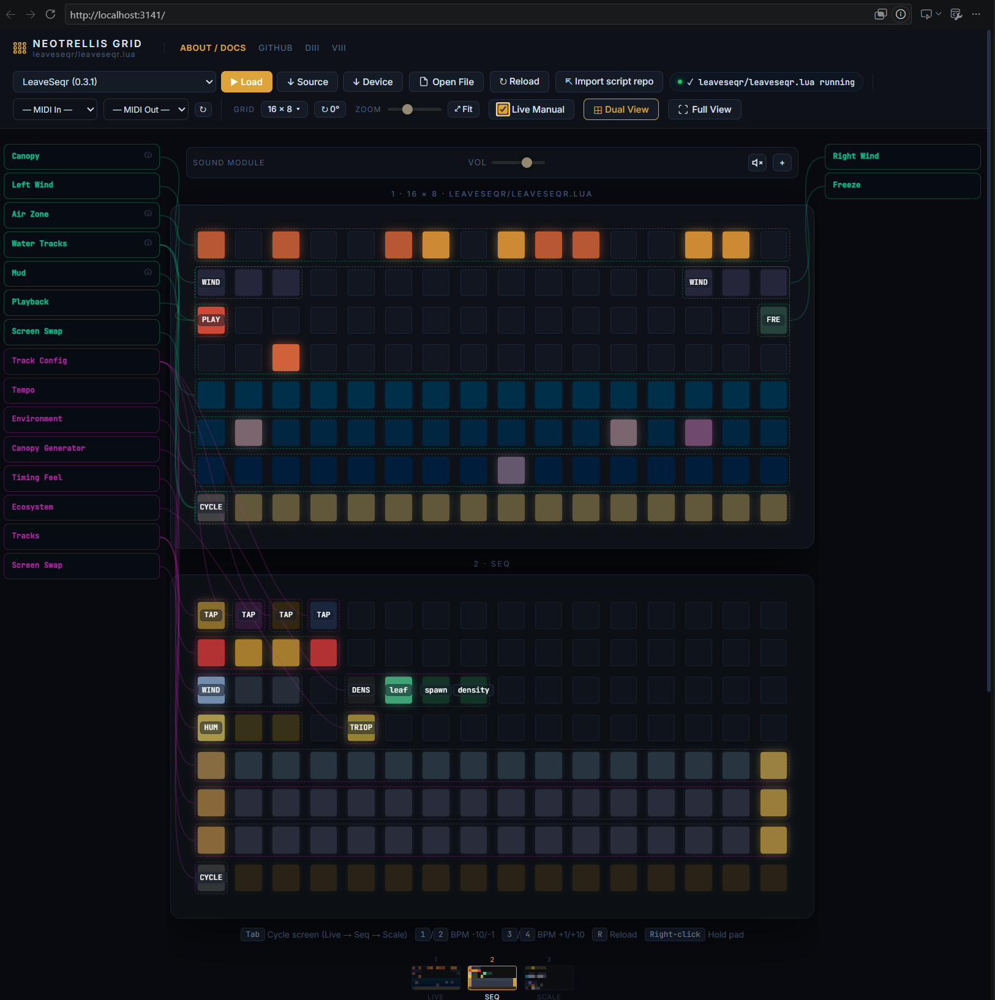
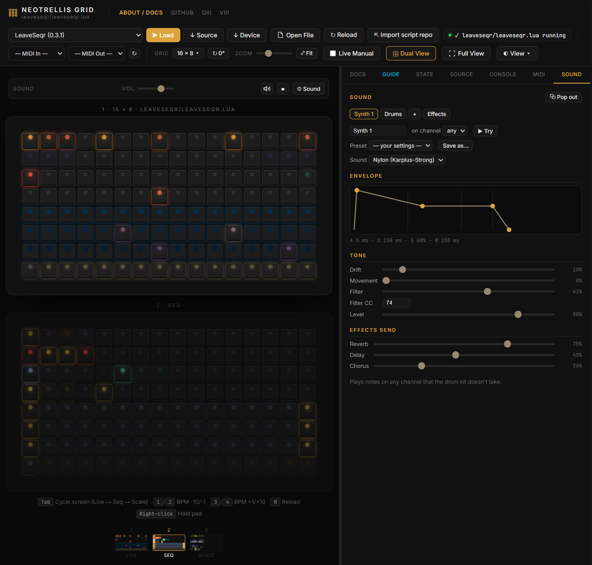

# diii-neotrellis-emulator

A browser emulator for [monome iii](https://monome.org/docs/iii/) grid scripts. It runs the same Lua scripts as a NeoTrellis or monome grid, plays them through a built-in synth or MIDI, and shows each script's controls on the grid as a live manual.

**[Open the emulator](https://jonwaterschoot.github.io/diii-neotrellis-emulator/)** · **[Documentation](https://jonwaterschoot.github.io/diii-neotrellis-emulator/docs/)**

## What you can do

- **Play scripts:** the bundled ones, scripts by others (loaded from their own repositories), any GitHub or Codeberg repository, or a file from your computer.
- **Hear them:** several synths at once (from soft keys to Karplus–Strong strings) and a drum kit, with reverb, delay and chorus; MIDI out to a synth or DAW, and MIDI in for scripts that follow a clock or a keyboard.
- **Read them:** each script's controls are drawn over the grid, its README shows in the Guide tab and its code in the Source tab.
- **Write them:** edit and run a script in the browser, or in your own editor with live reload. **↓ Device** makes a smaller copy for uploading and warns about code the device won't load.
- **See them your way:** NeoTrellis pads or Mechatrellis keys, dark or light, in colour or as a monochrome monome grid.

## Getting started

- [Use it in the browser](https://jonwaterschoot.github.io/diii-neotrellis-emulator/docs/getting-started/#use-it-in-the-browser), nothing to install.
- [Run it on your computer](https://jonwaterschoot.github.io/diii-neotrellis-emulator/docs/getting-started/#run-it-on-your-computer) to write scripts: `npm install`, then `npm start`.
- [Put scripts on a NeoTrellis grid](https://jonwaterschoot.github.io/diii-neotrellis-emulator/docs/getting-started/#put-scripts-on-a-neotrellis-grid): the firmware is on the [firmware release page](https://github.com/jonwaterschoot/neotrellis-monome/releases/latest).

## Documentation

- [Walkthrough](https://jonwaterschoot.github.io/diii-neotrellis-emulator/docs/walkthrough/): the emulator's screen, part by part.
- [Hardware vs. emulator](https://jonwaterschoot.github.io/diii-neotrellis-emulator/docs/hardware-vs-emulator/): what behaves differently on the device, and what to check before uploading.
- [Start a script](https://jonwaterschoot.github.io/diii-neotrellis-emulator/docs/start-a-script/), the [script standard](https://jonwaterschoot.github.io/diii-neotrellis-emulator/docs/script-standards/) and [colour and monochrome](https://jonwaterschoot.github.io/diii-neotrellis-emulator/docs/colour/): writing scripts that work on both kinds of grid.
- [Developer guide](https://jonwaterschoot.github.io/diii-neotrellis-emulator/docs/developer-guide/): how the emulator works inside.

## Scripts

My scripts, as grouped in the emulator's script list:

- **Music:** [LeaveSeqr](https://github.com/jonwaterschoot/diii-neotrellis-emulator/blob/main/scripts/leaveseqr/README.md) (falling leaves become three sequencer tracks), [Sandman](https://github.com/jonwaterschoot/diii-neotrellis-emulator/blob/main/scripts/sandman/README.md) (falling sand, leaves and water as music), [Serpentine](https://github.com/jonwaterschoot/diii-neotrellis-emulator/blob/main/scripts/serpentineSeqr/README.md) (a snake game sequencer).
- **Colour demos:** [colour fallback demo](https://github.com/jonwaterschoot/diii-neotrellis-emulator/blob/main/scripts/colorfallback/color_fallback_demo.lua), [monochrome fallback](https://github.com/jonwaterschoot/diii-neotrellis-emulator/blob/main/scripts/colorfallback/monochrome_fallback.lua), [colour workaround demo](https://github.com/jonwaterschoot/diii-neotrellis-emulator/blob/main/scripts/colorfallback/color-workaround-demo.lua), [text runner](https://github.com/jonwaterschoot/diii-neotrellis-emulator/blob/main/scripts/displayfun/textrunner.lua).
- **Tests:** [multiple screens](https://github.com/jonwaterschoot/diii-neotrellis-emulator/blob/main/scripts/multiplescreen-test/README.md), [grid colour](https://github.com/jonwaterschoot/diii-neotrellis-emulator/blob/main/scripts/colorfallback/test-grid-color.lua), [colour threshold](https://github.com/jonwaterschoot/diii-neotrellis-emulator/blob/main/scripts/colorfallback/color-threshold-test.lua), [power](https://github.com/jonwaterschoot/diii-neotrellis-emulator/blob/main/scripts/powertest/power_test.lua).
- **Write your own:** the [script template](https://github.com/jonwaterschoot/diii-neotrellis-emulator/tree/main/scripts/template), with a step-by-step [guide](https://github.com/jonwaterschoot/diii-neotrellis-emulator/blob/main/scripts/template/GUIDE.md) and [instructions to give an LLM](https://github.com/jonwaterschoot/diii-neotrellis-emulator/blob/main/scripts/template/LLM_INSTRUCTIONS.md).

### Scripts by others

The emulator's script list also offers scripts by other people. They are not my work and they are not part of this project or copied into this repo: [`scripts/external.json`](https://github.com/jonwaterschoot/diii-neotrellis-emulator/blob/main/scripts/external.json) only holds their names and repository links, and the emulator fetches each script from its author's repository when you load it. All credit goes to the authors.

If you wrote one of these and would rather not be listed, please [open an issue](https://github.com/jonwaterschoot/diii-neotrellis-emulator/issues) and I'll take it out.

- [kria iii](https://github.com/aktsom/kria_iii) by aktsom
- [stepiii](https://github.com/nolliegray/stepiii) by nolliegray
- [arpiii](https://github.com/nolliegray/arpiii) by nolliegray
- [fugace](https://github.com/behindkeyframes/fugace) by behindkeyframes
- [iiinvert](https://github.com/liamelliot/iiinvert) by liamelliot
- [fell](https://github.com/liamelliot/fell) by liamelliot
- [sluiiice](https://github.com/duncangeere/sluiiice) by duncangeere
- [many-roads](https://github.com/boreal-ground/many-roads-grid) by boreal-ground

The list also has my own [selector](https://github.com/jonwaterschoot/neotrellis-monome/tree/main/neotrellis_monome_picosdk_iii/doc/scripts/selector), which lives in the firmware repo, and tehn's scripts from [monome's iii-scripts](https://codeberg.org/tehn/iii-scripts).

## Background

This started as an interactive manual for my Serpentine script. Once it could play the script, I kept going until it could run other scripts too.

I have a few DIY projects from okyeron, and it was through his Discord that I got curious about diii. I built my own version of [okyeron's NeoTrellis firmware](https://github.com/okyeron/neotrellis-monome) with iii and colour support: [jonwaterschoot/neotrellis-monome](https://github.com/jonwaterschoot/neotrellis-monome). It also uses [my fork of iii](https://codeberg.org/jonwaterschoot/iii/src/branch/fix/streaming-upload), which can upload scripts larger than about 32 KB, such as LeaveSeqr ([details](https://github.com/jonwaterschoot/neotrellis-monome/blob/main/neotrellis_monome_picosdk_iii/doc/changestracker/leaveseqr-upload-failure-investigation.md)).

I don't own original monome gear, so the monochrome side is tested with the [viii](https://dessertplanet.github.io/viii/) web app on my NeoTrellis grid.

> [!IMPORTANT]
> This is a vibecoded project: I'm not a C++ developer, and I built it with Claude and Gemini in VS Code and Google Antigravity. I have still spent many hours on it and learned a lot about the ecosystem.

## Links

- [monome iii documentation](https://monome.org/docs/iii/), and the [diii web app](https://monome.org/diii/) ([source](https://github.com/monome/web-diii)) to upload scripts to a grid
- [iii release post](https://llllllll.co/t/iii/74311) on the lines forum, by tehn (Brian Crabtree), with scripts such as [meadowphysics](https://monome.org/docs/iii/library/mp/), [intervals](https://monome.org/docs/iii/library/intervals) and [wake](https://monome.org/docs/iii/library/wake)
- [okyeron/neotrellis-monome](https://github.com/okyeron/neotrellis-monome): use Adafruit NeoTrellis boards as a monome grid

Please don't ask monome or the lines forum about the NeoTrellis colour features: they're mine, not monome's.

## License

My own work in this repository is under the **GPL-3.0 License**: I want to share what I make freely with the community. I'm still looking into the licenses of the third-party parts it uses. If I've got something wrong, please let me know.
