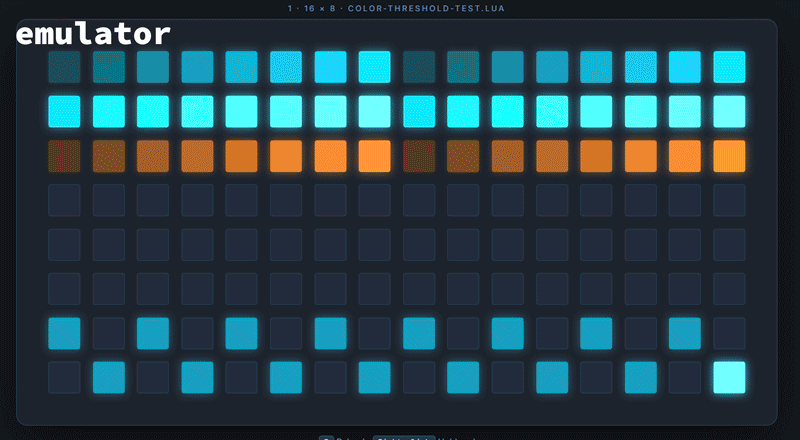

# Colour and monochrome

A NeoTrellis grid with my firmware shows colour. A monome grid shows 16 brightness levels of one colour. A script can work on both: it draws in colour where colour exists, and falls back to brightness levels where it doesn't.


*`color_fallback_demo.lua` on a NeoTrellis grid.*

## The functions

| Function | NeoTrellis firmware | Monome grid (iii) |
|---|---|---|
| `grid_led(x, y, level)`, `grid_led_all(level)` | Yes, in the current tint | Yes |
| `grid_color(r, g, b)` | Sets the tint for `grid_led` and `grid_led_all` | Doesn't exist |
| `grid_led_rgb(x, y, r, g, b)` | Sets one pad's colour, ignoring the tint | Doesn't exist |
| `grid_color_intensity(level)` | Overall brightness | Doesn't exist |

On a monome grid, calling a function that doesn't exist stops the script with an error. Check first:

```lua
if grid_color then grid_color(255, 120, 20) end
```

To test your script without colour, pick **◐ View → Monochrome** in the emulator: the colour functions disappear, as on a monome grid, and a missing check shows up as an error. On hardware, [viii](https://dessertplanet.github.io/viii/) does the same, since it only has `grid_led`.


*`color_fallback_demo.lua` on the NeoTrellis grid after testing its monochrome version in viii.*

## Three ways to use colour

| Approach | Use it for | On a monome grid |
|---|---|---|
| `grid_color` + `grid_led` | One colour for the whole grid | Same brightness levels, without the colour |
| `spx` helper (below) | Several colours, with a fallback | Each colour becomes a brightness level |
| `grid_led_rgb` only | Colour that only makes sense on RGB | Nothing lights up |

### One colour for the whole grid

Set the tint once and draw as you would in monochrome:

```lua
if grid_color then grid_color(255, 120, 20) end -- amber

grid_led(1, 1, 15) -- bright amber
grid_led(2, 1, 8)  -- mid amber
grid_refresh()
```

The default tint is white. On my firmware, people can also pick a default tint at startup (see [Getting started](getting-started.md#startup-options)). Scripts that set their own colours aren't affected by it.

### Several colours, with a fallback

Draw every pad through one helper. On a NeoTrellis grid it sets the colour; elsewhere it turns the brightest channel into a level from 4 to 15:

```lua
local W, H = grid_size_x(), grid_size_y()

local function spx(x, y, r, g, b)
  if x < 1 or x > W or y < 1 or y > H then return end
  if grid_led_rgb then
    grid_led_rgb(x, y, r, g, b)
  else
    -- Levels 1–3 can't be seen on NeoTrellis LEDs and are very dim on monome
    -- grids, so anything that isn't black gets at least level 4.
    local level = math.floor(math.max(r, g, b) / 17)
    if level < 4 and (r > 0 or g > 0 or b > 0) then level = 4 end
    grid_led(x, y, level)
  end
end

spx(1, 1, 255, 80, 20) -- orange, or level 15
spx(2, 1, 20, 100, 255) -- blue, or level 15
spx(3, 1, 0, 40, 0)    -- dark green, or level 4
```

The contrast between your colours becomes the contrast between brightness levels. Full example: [`color_fallback_demo.lua`](https://github.com/jonwaterschoot/diii-neotrellis-emulator/blob/main/scripts/colorfallback/color_fallback_demo.lua).

## Dim colours on NeoTrellis

Each NeoTrellis pad mixes red, green and blue LEDs. At low brightness, the weaker channels drop out before the others, so a tinted colour can change hue. Orange (lots of red, some green) turns red when the green fades out first. Measured with `grid_led` and a tint:

| Level | What you see |
|---|---|
| 1–2 | Nothing |
| 3 | First visible level; the colour may be off |
| 4–7 | Visible, but cyan and blue tints can look orange or red |
| 8–15 | Accurate colour |

`grid_led_rgb` keeps its colour better at low brightness.



*`color-threshold-test.lua`: tinted `grid_led` on the left, `grid_led_rgb` on the right.*

The emulator doesn't show these shifts. What helps:

- Keep tinted pads at level 8 or higher.
- For dim colours, use `grid_led_rgb` and keep every channel you need above about 20.
- Use level 0 for off, and at least level 4 for on.

The thresholds can vary between NeoTrellis boards. To check yours, run [`color-threshold-test.lua`](https://github.com/jonwaterschoot/diii-neotrellis-emulator/blob/main/scripts/colorfallback/color-threshold-test.lua). [`color-workaround-demo.lua`](https://github.com/jonwaterschoot/diii-neotrellis-emulator/blob/main/scripts/colorfallback/color-workaround-demo.lua) shows the `grid_led_rgb` workaround.
