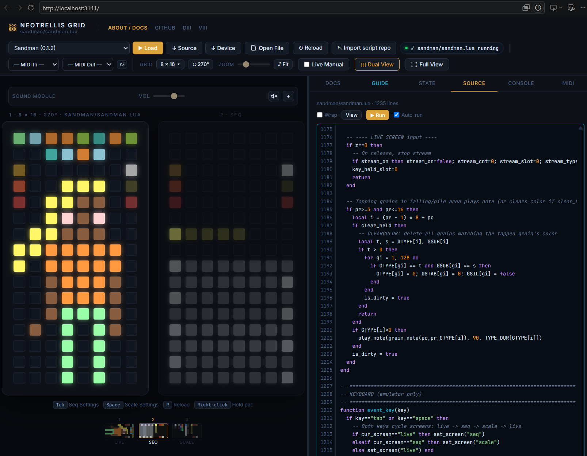

# Walkthrough

The emulator's screen, part by part. To get it running, see [Getting started](getting-started.md).

## Loading a script

The script list at the top has these groups:

- **Recent:** scripts you imported or opened, and scripts you edited, kept in this browser. **✕ Clear recent** empties it.
- **Music, Colour demos, Tests, Write your own:** the scripts that come with the emulator.
- **External scripts:** scripts by other people, loaded from their own repositories each time.
- **tehn:** scripts from monome's iii-scripts.

Pick one and press **▶ Load**. Other ways to load a script:

- **Open File:** a `.lua` file from your computer.
- **⇱ Import script repo:** paste a GitHub or Codeberg address, such as `github.com/owner/repo` or `owner/repo`. The emulator finds the `.lua` file and the README.

The other buttons:

- **↻ Reload** (or R) starts the script again.
- **↓ Source** downloads a bundled script as it is.
- **↓ Device** downloads a copy without comments, ready to upload, and warns about code the device won't load (see [Hardware vs. emulator](hardware-vs-emulator.md)).

The status bar next to them shows what's happening, including errors and warnings. Scripts can set their grid size and rotation; the emulator switches to it when they load.

## The grid

- **Click** a pad to press it.
- **Right-click** holds a pad down; right-click again to let go. Use it for chords, or for a button you'd otherwise hold.
- **Grid** sets the size (8×8, 16×8, 8×16, 16×16), **↻ 0°** rotates it, and the zoom slider and **⤢ Fit** set how big it is on screen.
- **Full View** shows only the grid. Its buttons open the sound and zoom controls; Esc leaves.
- **◐ View** sets the theme (dark or light), the keys (**NeoTrellis**: the whole pad lights up; **Mechatrellis**: dark keys close together, with an LED at the top), the pad corners (square, slightly round, round), and the grid: **Colour** like a NeoTrellis grid, or **Monochrome** like a monome grid. In monochrome the script doesn't get `grid_led_rgb`, `grid_color` and `grid_color_intensity`, so it runs its own fallback; the grid label says "mono".

The line under the grid shows the script's own keyboard shortcuts, if it lists any.

### Scripts with more than one screen

Some scripts draw more than one screen, such as a main screen and a settings page.

- Small thumbnails of each screen sit under the grid. Click one to show that screen.
- **⊞ Dual View** shows a second screen next to the main grid.

See [multiple screens](multi-screen-test.md) for how a script does this.

### Live Manual

The **Live Manual** switch draws the script's controls over the grid: labels with lines to the pads they belong to. The labels come from comments in the script (see the [script standard](script-standards.md)). A panel with the script's guide opens next to it.

## The side panel

| Tab | Shows |
|---|---|
| **Docs** | The script's name, version and author, and its controls, read from the comments in the script |
| **Guide** | The script's README |
| **State** | The starting values of simple variables in the script |
| **Source** | The script's code, coloured, with line numbers; see below |
| **Console** | Everything the status bar showed. The script's own `print` output goes to the browser's developer console (F12) |
| **MIDI** | Every MIDI message going in and out; see below |
| **Sound** | The synth's sound and the drum kit; see [Sound](#sound) |

Drag the edge of the panel to make it wider.

### Source

- **Wrap** wraps long lines. When a Lua error names a line, that line is marked, and the link at the top jumps to it.
- **✎ Edit** opens the code in an editor. **▶ Run** (or Ctrl+Enter) runs your version. **Auto-run** runs it again a second after you stop typing.
- Lines you changed are flagged: amber for changed, green for added, a red tick where lines were removed. Click a flag to put that part back, or **↺ Restore all**. Ctrl+Z undoes a restore.
- Your edited version is kept under Recent. It isn't saved to a file: use **↓ Device** or copy it out.

### MIDI monitor

The buttons at the top filter what's shown: notes, CC, clock, other messages, incoming, outgoing. **⏸ Pause** stops capturing (the list and the counters at the bottom) and **⌫ Clear** empties it.

## Sound

The emulator plays every note the script sends: drum notes on the drum kit, the others on the synths. Under the grid are the volume, the speaker button and **⚙ Sound**, which opens the Sound tab (or, in Full View, the Sound window). Sound starts muted; the first click on the grid turns it on.

The sound also plays when a MIDI output is selected. Mute it to hear only your own synth.

### The Sound tab

Along the top: a tab for each synth, **Drums**, **+** to add a synth, and **Effects**.

**A synth** plays the notes on its channel (or on any channel) that the drum kit doesn't take. Synths on the same channel play together, so two can be layered.

- **Name** and **channel**, **▶ Try** to hear it, **✕** to remove it.
- **Preset:** a starting point (Soft keys, Warm pad, Glass bell, Pluck, Drifting lead, Hollow bass), or one you saved with **Save as…** (kept in this browser).
- **Sound:** Triangle, Sine, Soft saw, Hollow square, Wide pad, Pluck or FM bell.
- **Envelope:** drag the points. The first sets the attack, the second the decay and sustain level, the line after it the sustain level, the last the release.
- **Drift** puts each note a little out of tune and lets it wander slowly; **Movement** sweeps each note's filter slowly.
- **Filter:** a low-pass filter, which also follows a CC (74 to start with) on the synth's channel, from the script or from MIDI in.
- **Level**, and how much it sends to the reverb, delay and chorus.

**Drums:** seven drums (kick, snare, closed and open hat, clap, tom, perc), made by the emulator rather than recorded.

- **Plays drum notes on channel …:** notes on that channel (10 to start with, or any) play drums by their General MIDI number: 36 kick, 38 snare, 39 clap, 42 closed hat, 46 open hat, and so on. Notes 36 to 51, the usual 4×4 pad layout, are all covered. Other notes go to the synths.
- **Plays a channel per drum:** each drum plays on any note on its own channel (10 to 16 to start with).
- **▶** plays a drum, and flashes whenever the script plays it. **⚄** makes a new version of that drum; **⚄ All** does all of them.
- The closed hat cuts off the open hat, as on a real kit. The kit has its own level and effect sends.

A script such as iiinvert sends its drums on channel 1: set the kit to channel 1 to hear them as drums.

**Effects**, shared by all synths and the kit:

- **Reverb:** *Large room / hall* (a short gap, then a tail that darkens) or *Plate / spring* (bright and dense straight away). A new decay applies when you let go of the slider.
- **Delay:** time and feedback.
- **Chorus:** rate and depth.
- **Quality:** *Light* plays fewer notes at once and has a shorter reverb, no chorus and no drift or movement, for phones. *Auto* picks light on phones.

**⧉ Pop out** moves the Sound controls into a window of their own, which you can drag by its title and resize from its corner; **Dock** puts them back. Everything in the Sound tab is kept in this browser.

## MIDI

Pick a **MIDI In** and **MIDI Out** at the top (Chrome or Edge); **↻** looks for new devices. The first time, the browser asks whether the page may use MIDI devices: allow it, or the lists stay empty.

The lists show the MIDI devices your computer knows. To reach a DAW or another program on the same computer, most systems need a virtual MIDI port; how to make one depends on your system.

- **Out** sends the script's notes, CCs and clock.
- **In** goes to the script's `event_midi`, for scripts that follow an external clock or a keyboard. For a script without `event_midi`, incoming notes press pads instead.

If the same device is both input and output, a script can hear its own messages; the status bar warns when that happens.

**Timing.** The emulator keeps tempo, but each note or clock tick can be a few milliseconds early or late, and more when the tab is in the background. That's fine for playing along; for tight sync with other gear, let the script follow an external clock (MIDI In), or run it on the grid. More in [Hardware vs. emulator](hardware-vs-emulator.md#midi).

## Keyboard shortcuts

**R** always reloads the script. The line under the grid shows what the other keys do in the loaded script.

A script can handle keys itself, with `event_key` (see the [script standard](script-standards.md#6-keyboard-shortcuts)). Sandman and LeaveSeqr do: Tab moves to their next screen. For a script without `event_key`, these keys press fixed pads:

| Key | Presses |
|---|---|
| Tab | x1, y8, while the key is down |
| Space | x1, y8 |
| ↑ ← ↓ → | x15 y7, x14 y8, x15 y8, x16 y8 |
| 1, 2, 3, 4 | x10–x13, y3 |
| A | x1, y3 |

These match Serpentine's layout (ALT, the D-pad, tempo, autopilot). Keys don't reach the grid while you type in a text field, or with Ctrl or Cmd held.

## Kept in your browser

The emulator remembers, in this browser only:

- the Recent list, including edited scripts
- presets that scripts save with `pset_write`
- the Source tab's Wrap and Auto-run settings
- the theme, keys, pad corners and grid mode from ◐ View
- the synths, drum kit, effects and quality settings, your saved presets, and where the Sound window was

Clearing the site's data in your browser removes them.
